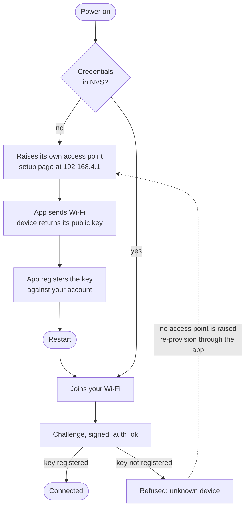
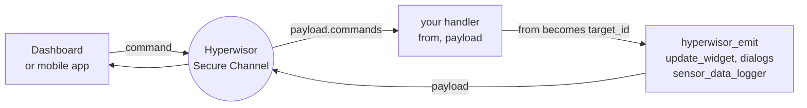

# Hyperwisor IoT for ESP-IDF

[](https://components.espressif.com/)
[](https://docs.espressif.com/projects/esp-idf/)
[](#security)
[](LICENSE)

Wi-Fi provisioning, an authenticated real-time channel, a cloud command
runtime, dashboard widgets, NTP and NVS helpers, with optional OTA and GPIO —
behind one umbrella header.

Every device generates an **ECDSA P-256 keypair on-chip**. The private key
never leaves the ESP32, and the device proves its identity to the Hyperwisor
Secure Channel before any data flows.

* **Targets** — ESP32, S2, S3, C3, C6, P4
* **ESP-IDF** — `>= 5.5, < 7.0`
* **UI** — framework-agnostic. LVGL, raw, or none

---

## Install

```yaml
# main/idf_component.yml
dependencies:
  nikolaindustry/hyperwisor: "^0.5.0"
```

Then `idf.py reconfigure`. The dependency manager pulls
`espressif/esp_websocket_client` and `espressif/cjson` for you.

---

## Quick start

```c
#include "hyperwisor.h"

void app_main(void)
{
    hyperwisor_init();
    hyperwisor_enable_security();   /* on-chip key; prints it once at boot */
    hyperwisor_start();             /* spawns the core task */
}
```

`hyperwisor_start()` joins Wi-Fi, authenticates on the secure channel and
begins accepting commands. With no stored credentials it raises its own access
point instead and serves a provisioning page.

Register handlers **before** `hyperwisor_start()`, so a command arriving on the
first connection is not answered with "Unknown command".

---

## How a device reaches your account

A device cannot simply connect. The relay only accepts devices whose public key
is registered to an account, so the first boot goes through provisioning.



The access point is named `NIKOLAINDUSTRY_Setup` plus the last six characters
of the device id, password `0123456789`.

> A device given credentials in code skips provisioning, never registers its
> key, and is refused as `unknown device` — and because it now *has*
> credentials it will not raise its access point again. Use
> `hyperwisor_hsc_register()` as well, or provision through the app.

---

## How a message flows

Everything you send is addressed to a `target_id`. Inside a command handler
that is the `from` argument — the dashboard that asked — so a reply, a widget
update and a dialog all go back to wherever the command came from.



Hold that one idea and the rest of the API follows: **the thing you received
from is the thing you send to.**

---

## Handling commands

```c
static void cmd_relay(const char *from, cJSON *payload)
{
    cJSON *params = hyperwisor_cmd_find_params(payload, "relay_control", "update");
    if (!params) return;

    cJSON *state = cJSON_GetObjectItem(params, "state");
    bool on = cJSON_IsString(state) && strcmp(state->valuestring, "true") == 0;
    /* drive your hardware here */

    cJSON *reply = cJSON_CreateObject();
    cJSON_AddStringToObject(reply, "status", "ok");
    hyperwisor_send_response(from, reply);
    cJSON_Delete(reply);
}

hyperwisor_register_cmd_handler("relay_control", cmd_relay);
```

`payload` is the whole envelope, so the helpers do the digging. The dashboard
sends parameters as **strings** — `"true"`, not `true` — which is worth knowing
before you write `cJSON_IsBool()` and wonder why nothing happens.

Sending is the same envelope in reverse:

```c
cJSON *params = cJSON_CreateObject();
cJSON_AddStringToObject(params, "relay", "1");
hyperwisor_emit(target, "relay_control", "update", params);  /* takes ownership */
```

---

## Connection behaviour

| Situation | What happens |
|---|---|
| Link drops | Backs off 5s, 10s, 20s, 40s, capped at 60s |
| Jitter | Each retry lands in a window as wide as the wait itself |
| Identity rejected | Flat 5s retry, no escalation |
| Handshake completes | Backoff resets — only `auth_ok` counts as success |

The jitter matters once more than one device exists. A fixed interval means
every device reconnects in lockstep after a server restart, and the burst keeps
the server down. A window that widens with the delay puts the largest spread
where the crowd is biggest.

Two behaviours worth knowing, both learned the hard way:

- **A clean close is not a disconnect.** `esp_websocket_client` raises
  `WEBSOCKET_EVENT_CLOSED` for a graceful close and `WEBSOCKET_EVENT_DISCONNECTED`
  only for a broken one. The relay refuses an unknown device with a *clean*
  close, so a client that handles only `DISCONNECTED` never retries.
- **Power save is an explicit choice.** IDF defaults to `WIFI_PS_MIN_MODEM`,
  which misses beacons on a busy 2.4 GHz band and disassociates. Mains-powered
  panels want `HYPERWISOR_WIFI_PS_NONE`; a sensor on a coin cell wants the
  opposite. Set it deliberately.

---

## Security

`hyperwisor_enable_security()` generates or loads the device's P-256 keypair in
NVS. On connect the relay issues a challenge, the device signs it, and nothing
the application sends leaves before `auth_ok`.

- The **private key never leaves the chip.** Only the public key is shared.
- The keypair survives reboots and OTA, so the identity is stable.
- Application frames written before the handshake finishes are **held**, not
  sent — a publishing loop that starts early cannot break the connection.

```c
char pub[128];
hyperwisor_get_public_key_b64(pub, sizeof(pub));   /* safe to print */
```

---

## Features (Kconfig)

| Symbol | Default | Purpose |
| --- | --- | --- |
| `HYPERWISOR_ENABLE_SYSTEM` | y | Built-in `SYSTEM` command: restart, status, info |
| `HYPERWISOR_ENABLE_NTP` | y | SNTP sync once Wi-Fi is up |
| `HYPERWISOR_ENABLE_HTTP` | y | `hyperwisor_http_get/post` helpers |
| `HYPERWISOR_ENABLE_WIDGET` | y | Push live values to dashboard widgets |
| `HYPERWISOR_ENABLE_OTA` | n | OTA through the `OTA_UPDATE` command |
| `HYPERWISOR_ENABLE_GPIO` | n | Cloud-driven GPIO, allowlisted |
| `HYPERWISOR_ENABLE_DISPLAY` | n | Backlight through the board port |

`DEVICE_STATUS` is always registered. Asking a device whether it is alive is
not an application concern, and a device that cannot answer it is simply
broken.

### Endpoints

```kconfig
CONFIG_HYPERWISOR_WS_HOST="hyperwisor-realtime-secure.onrender.com"
CONFIG_HYPERWISOR_WS_PORT=443
CONFIG_HYPERWISOR_HTTP_BASE_URL="https://platform.hyperwisor.com/functions/v1"
```

Those are the defaults and point at the live platform. Override only when
self-hosting.

---

## OTA

1. In `sdkconfig.defaults`:
   ```
   CONFIG_HYPERWISOR_ENABLE_OTA=y
   CONFIG_PARTITION_TABLE_CUSTOM=y
   CONFIG_PARTITION_TABLE_CUSTOM_FILENAME="partitions_16mb_ota.csv"
   ```
2. Copy the matching CSV from `components/hyperwisor/partitions/` into your
   project root. 4 MB, 8 MB and 16 MB variants are bundled.
3. Build and flash. The dashboard's update button now works.

> Without Secure Boot V2, OTA is **unauthenticated** — anyone who can reach the
> device's session can push arbitrary firmware. Enable Secure Boot V2 and Flash
> Encryption for production.

---

## API

### Lifecycle

| Function | Purpose |
|---|---|
| `hyperwisor_init()` | Bring up NVS, Wi-Fi, state. Call first |
| `hyperwisor_enable_security()` | Create or load the on-chip identity |
| `hyperwisor_start()` | Connect and spawn the core task |
| `hyperwisor_get_state()` | Live state; read under the lock |
| `hyperwisor_state_lock()` / `_unlock()` | Guard state from another task |
| `hyperwisor_set_port(&port)` | Board hooks: GPIO allowlist, backlight, name |

### Commands

| Function | Purpose |
|---|---|
| `hyperwisor_register_cmd_handler(cmd, fn)` | Handle one command name |
| `hyperwisor_register_user_msg_cb(cb)` | See every inbound message |
| `hyperwisor_cmd_find_params(payload, cmd, action)` | Dig params out of the envelope |
| `hyperwisor_emit(target, cmd, action, params)` | Send a command. Takes ownership of `params` |
| `hyperwisor_send_response(to, payload)` | Reply to a sender |
| `hyperwisor_send_to(target, builder)` | Send an arbitrary payload |
| `hyperwisor_cmd_process(json)` | Feed a message in by hand |

### Dashboard widgets

| Function | Purpose |
|---|---|
| `hyperwisor_update_widget_string/float(...)` | Text, gauges, numeric displays |
| `hyperwisor_update_widget_float_array/int_array/string_array(...)` | Graphs, charts, lists |
| `hyperwisor_update_countdown(...)` | Countdown widget |
| `hyperwisor_update_flight_attitude(..., roll, pitch)` | Artificial horizon, degrees |
| `hyperwisor_update_heat_map(..., points, count)` | `hyperwisor_heat_map_point_t[]` |
| `hyperwisor_update_3d_model(..., url)` | Load a model into a 3D viewer |
| `hyperwisor_update_3d_widget(..., models, count)` | `hyperwisor_3d_model_update_t[]` |
| `hyperwisor_update_widget_position(..., x, y, w, h, r)` | Move, resize, rotate |

### Dialogs

`hyperwisor_info_dialog`, `_success_dialog`, `_warning_dialog`, `_error_dialog`,
`_risk_dialog` — all `(target, title, description)`. `hyperwisor_show_dialog()`
takes any icon name.

### Telemetry and status

| Function | Purpose |
|---|---|
| `hyperwisor_send_sensor_data_logger(target, config_id, ...)` | Push readings to a Data Logger |
| `hyperwisor_send_device_status(target)` | Report status on demand |

### Identity and credentials

| Function | Purpose |
|---|---|
| `hyperwisor_get_device_id(buf, len)` / `_get_user_id(...)` | Identity |
| `hyperwisor_get_public_key_b64(buf, len)` | Public key, base64 raw P-256 |
| `hyperwisor_set_credentials(ssid, pass, device, user)` | Everything at once |
| `hyperwisor_set_wifi_credentials` / `_set_device_id` / `_set_user_id` | Individually |
| `hyperwisor_set_api_keys(key, secret)` | Service credentials |
| `hyperwisor_has_credentials()` / `_clear_credentials()` | Inspect or wipe |
| `hyperwisor_hsc_register(base_url, token)` | Register the key without the app |
| `hyperwisor_hsc_erase()` | Destroy the identity. The device becomes unknown |

### Network time

`hyperwisor_ntp_init(tz)`, `_set_timezone(tz)`, `_get_time`, `_get_date`,
`_get_datetime` — each writing into a caller-supplied buffer.

### Wi-Fi

| Function | Purpose |
|---|---|
| `hyperwisor_wifi_is_connected()` | Station associated |
| `hyperwisor_wifi_get_ip(buf)` | Current address |
| `hyperwisor_wifi_connect(ssid, pass)` | Join a network directly |
| `hyperwisor_wifi_start_ap` / `_stop_ap` | Raise or drop the setup AP |
| `hyperwisor_wifi_start_provisioning_server` / `_stop_...` | The setup page |
| `hyperwisor_wifi_register_cb(cb)` | Connect, disconnect, got-IP events |

### OTA and GPIO

Available when their Kconfig symbols are on.

| Function | Purpose |
|---|---|
| `hyperwisor_ota_perform(url)` | Update now |
| `hyperwisor_ota_get_version(buf, len)` / `_get_progress()` | Version, percent |
| `hyperwisor_ota_is_in_progress()` | Do not reboot while true |
| `hyperwisor_gpio_set_allowlist(pins, count)` | **Required** — no allowlist, no cloud GPIO |
| `hyperwisor_gpio_set_pin_mode` / `_digital_write` / `_digital_read` | Direct control |
| `hyperwisor_gpio_save_state` / `_load_state` / `_restore_all_states` | Outputs across reboots |

---

## Examples

| Example | Shows |
|---|---|
| `examples/hello_hyperwisor` | Smallest connected device |
| `examples/secure_hyperwisor` | Identity, handshake, registering the key |

```bash
. $IDF_PATH/export.sh
cd examples/secure_hyperwisor
idf.py set-target esp32s3
idf.py -p /dev/ttyUSB0 flash monitor
```

---

## Links

* Platform and dashboard — <https://platform.hyperwisor.com>
* Issues — <https://github.com/nikolaindustry/hyperwisor_esp_idf/issues>
* Changelog — [CHANGELOG.md](CHANGELOG.md)

## Licence

Apache-2.0 — see [LICENSE](LICENSE).
